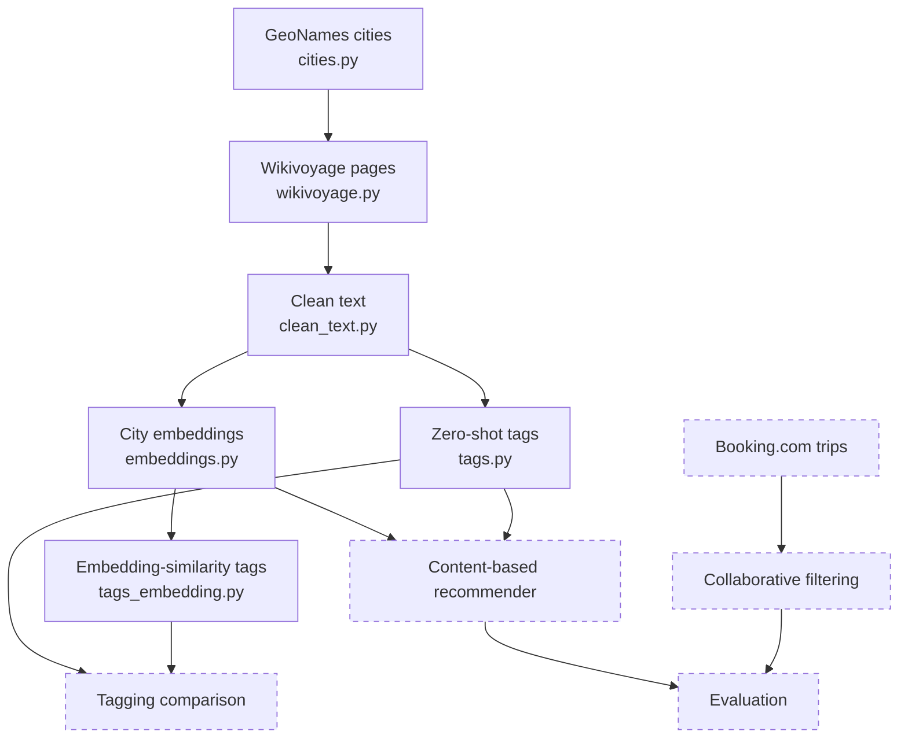

# Travel Recommender

A city recommender that suggests travel destinations based on what a person enjoys, using NLP on travel-guide text. Each city gets a profile built from its Wikivoyage article: a sentence embedding that captures what the place is like, and activity and budget tags that explain why it was recommended.

## Pipeline



Solid boxes are developed; dashed boxes are planned.

| Step | Script | Input | Output | Status |
|---|---|---|---|---|
| 1 | `data/cities.py` | GeoNames `cities15000.txt` | `data/interim/selected_cities.csv` | Developed |
| 2 | `data/wikivoyage.py` | `selected_cities.csv` | `data/interim/matched_cities.csv`, `data/raw/wikivoyage_pages.jsonl` | Developed |
| 3 | `data/clean_text.py` | `wikivoyage_pages.jsonl` | `data/processed/city_texts.jsonl` | Developed |
| 4 | `features/embeddings.py` | `city_texts.jsonl` | `artifacts/city_embeddings.npy`, `artifacts/city_index.csv` | Developed |
| 5a | `features/tags.py` | `city_texts.jsonl` | `artifacts/city_tags_<model>.csv` | Developed, full run pending |
| 5b | `features/tags_embedding.py` | `city_embeddings.npy`, `city_index.csv` | `artifacts/city_tags_embedding.csv` | Developed |
| 6 | Tagging comparison | outputs of 5a and 5b | | Planned |
| 7 | Content-based recommender | embeddings and tags | | Planned |
| 8 | Evaluation | recommender output | | Planned |
| 9 | Collaborative filtering | Booking.com trips | | Planned |

### Checks

Small scripts used to validate each step before running it on all cities:

| Script | Purpose |
|---|---|
| `scripts/check_tags.py` | Zero-shot activity and budget scores for a few well-known cities |
| `scripts/check_label_correlation.py` | Rank correlation between activity labels on a random sample of 100 cities |
| `scripts/check_tags_embedding.py` | Top cities per label for the embedding-similarity baseline |

## Design decisions

### Candidate selection: population is a starting point, not a filter
The largest cities by population are not necessarily the most visited destinations. GeoNames provides a broad candidate list, and the quality of each city's Wikivoyage article then decides whether it has enough content to describe. Districts of larger cities (GeoNames feature code `PPLX`) are excluded so they don't compete with the city they belong to.

### Collecting data through an API, not scraping
Article text comes from the MediaWiki API as structured JSON. Page metadata is requested in batches of 50 titles, while full text is fetched per page. Requests identify the project with a `User-Agent` header and pause between calls, following Wikimedia's API guidelines.

Matching by name alone produced wrong matches, such as a Bulgarian town matched to the Wikivoyage page for the US state of Montana, and city names redirecting to regional articles. Each match is therefore verified by comparing the Wikivoyage page's coordinates with the GeoNames city's coordinates using the haversine distance, and matches more than 50 km apart are rejected. When several cities share a page name, the closest one is kept.

### Section selection as feature selection on text
Wikivoyage city articles mix two kinds of content: sections describing a city's character (Understand, See, Do, Buy, Eat, Drink) and sections about logistics (Get in, Get around, Sleep, Stay safe, Connect). Every city has an airport, hotels and safety advice, so logistics text makes cities look more similar to each other in embedding space, which is the opposite of what a recommender needs. Only the character sections and the introduction are kept. Sections are stored separately, so later steps can use them individually, for example tagging activities from See and Do. Articles with fewer than 300 words after cleaning are dropped, since that is too little text to describe a city.

The Sleep section is kept as a separate column, used only to estimate how affordable a city is, since hotel price ranges are a strong cost signal. It is excluded from embeddings and activity tags.

### Section-balanced embeddings for long texts
City profiles are embedded with `all-MiniLM-L6-v2`, a compact sentence-transformer that runs on a laptop. The model reads at most 256 tokens, while the median city text is about 1,500 words, so embedding the full text directly would only capture its opening. Each section is split into 150-word chunks, every chunk is embedded, chunks are averaged into section vectors, and section vectors are averaged into one city vector. Averaging per section first gives every section an equal say: otherwise long sections, such as Eat pages listing dozens of restaurants, would dominate a city's profile. City vectors are normalized to unit length, so cosine similarity reduces to a dot product.

### Activity and budget tags with zero-shot classification
Tags are assigned with a zero-shot natural language inference model, which scores how strongly a text implies a hypothesis such as "This place is good for beaches." This needs no labeled training data. Activity labels are scored independently, since a city can suit several activities, and each label takes its highest score across a city's text chunks: one clear paragraph about beaches is enough evidence. Budget is a choice between "affordable" and "expensive", read from the Understand, Eat, Drink and Sleep sections, where guides discuss prices, and averaged across chunks, so a single mention of cheap street food doesn't make an expensive city look affordable. To keep run time manageable on a laptop, at most two chunks per section are scored. All raw scores are saved, so tag thresholds can be tuned without rerunning the model.

To check that the labels capture distinct information, activity scores were computed for a random sample of 100 cities and compared with Spearman rank correlation. No pair of labels exceeded 0.56 (hiking and nature), so all twelve labels were kept. The correlations form sensible groups, culture (museums, history, architecture, art), outdoors (hiking, nature) and lively cities (nightlife, food, festivals, shopping), and beaches correlate negatively with museums and art, suggesting the scores reflect real differences between destinations.

### Baseline: embedding similarity for tagging
As a baseline, the same labels are scored by cosine similarity between each label sentence and each city's embedding, using the same template and embedding model, so only the method differs. It is far cheaper, since city embeddings already exist. An early observation: because a city's embedding averages all its sections, cities focused on one theme score higher on it than multi-faceted cities, so small beach towns outrank major cities that also have excellent beaches. The zero-shot method takes the strongest chunk instead of the average and should not have this weakness. The two methods will be compared with per-label rank correlation, agreement on each label's top cities, and manual review of cities where they disagree.

## Project structure

```
src/travel_recsys/
├── data/         collecting and cleaning data
├── features/     embeddings and tags
├── models/       content-based and collaborative recommenders
└── evaluation/   metrics and test personas
scripts/          checks for individual steps
notebooks/        exploration only
```

## Setup

```bash
python3 -m venv travenv
source travenv/bin/activate
pip install -r requirements.txt
pip install -e .
```

Download the GeoNames city file into `data/raw/`:

```bash
curl -L -o data/raw/cities15000.zip https://download.geonames.org/export/dump/cities15000.zip
unzip data/raw/cities15000.zip -d data/raw
```

## Running the pipeline

Run the steps in order from the repository root. Each step reads the previous step's output, so after changing one step, rerun it and every step after it.

```bash
python -m travel_recsys.data.01cities
python -m travel_recsys.data.02wikivoyage
python -m travel_recsys.data.03clean_text
python -m travel_recsys.features.embeddings04
python -m travel_recsys.features.tags05a
python -m travel_recsys.features.tags_embedding05b
```

Steps 5a and 5b are independent of each other. The zero-shot tagging step is the slowest, taking up to an hour or more depending on the model.

## Results

- Name matches verified by coordinates: <N> of <N>
- Cities with usable text after cleaning: <N>
- Median article length after cleaning: <N> words
- City embeddings: <N> vectors of 384 dimensions

## Planned experiments

- Zero-shot tagging vs embedding-similarity baseline
- `deberta-v3-base-zeroshot-v2.0` vs `deberta-v3-large-zeroshot-v2.0` for tagging
- Including the Buy section as a budget signal
- An improved embedding baseline that takes the maximum similarity over chunks instead of the city average

## Data sources and licenses

- City data from [GeoNames](https://www.geonames.org/), licensed under CC BY 4.0.
- Destination text from [Wikivoyage](https://en.wikivoyage.org/), licensed under CC BY-SA.
- Trip sequences (phase 2) from the [Booking.com Multi-Destination Trips dataset](https://huggingface.co/datasets/Booking-com/multi-destination-trip-dataset).